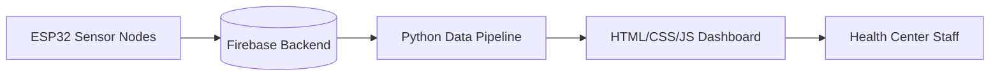
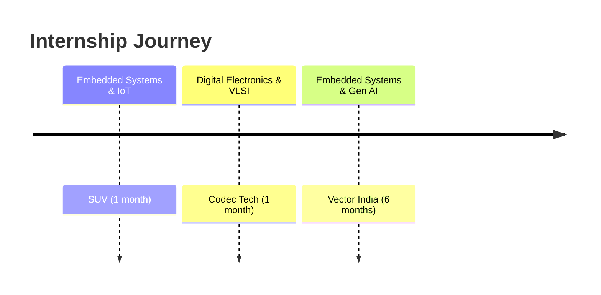

<!-- Animated waving header -->
<div align="center">


<!-- Typing animation -->
<a href="https://git.io/typing-svg">
  
</a>

<br/>


</div>

---

## 👨‍💻 About Me

```c
#include <stdio.h>

struct Engineer {
    const char *name;
    const char *degree;
    const char *focus[3];
    const char *goal;
};

int main(void) {
    struct Engineer akash = {
        .name   = "Akash E",
        .degree = "B.E. ECE, University College of Engineering, Villupuram (CGPA 8.0/10)",
        .focus  = {"Embedded C", "IoT", "Firmware"},
        .goal   = "Embedded Engineer role"
    };
    printf("Hello, I'm %s!\n", akash.name);
    return 0;
}
```

I build firmware and connected embedded solutions using C, Embedded C and Python, and I'm looking for an **Embedded Engineer** role where I can contribute to firmware development while growing my technical skills.

---

## 🛠️ Tech Stack

<div align="center">


</div>

| Area | Skills |
|------|--------|
| **Languages** | C, Embedded C, Python |
| **Microcontrollers** | ESP32, ESP8266, Arduino, NXP LPC2129 (ARM7TDMI-S) |
| **Protocols** | UART, I2C, SPI, CAN |
| **Tools** | Arduino IDE, VS Code, Git |

---

## 🚀 Projects

<table>
<tr>
<td width="50%" valign="top">

### 🌞 PV System Thermal Monitoring
ESP32 firmware in Embedded C that polls a DS18B20 sensor over one-wire and streams live readings to a **Blynk** IoT dashboard.

- Tracks solar panel temperature in real time
- Flags overheating within a 5°C threshold
- Dashboard updates every 10 seconds

`ESP32` `Embedded C` `DS18B20` `Blynk`

</td>
<td width="50%" valign="top">

### 🔐 Smart Bank Locker (Password + RFID)
Dual-factor locker access on the **LPC2129 ARM7**, written in Embedded C.

- Verifies an RFID card read over UART plus a keypad password
- Interfaces RFID reader, keypad and LCD
- Grants or denies access based on both credentials

`LPC2129` `Embedded C` `UART` `RFID`

</td>
</tr>
<tr>
<td colspan="2" valign="top">

### 🏥 Next-Gen Smart Rural Healthcare Management System
An IoT platform for patient registration, records and real-time monitoring at primary health centers.



- Staff access patient records in real time
- Cut patient registration time by **~40%** versus manual paper records

`ESP32` `Firebase` `Python` `HTML/CSS/JS`

</td>
</tr>
</table>

---

## 💼 Experience & Internships



---

## 🎓 Education

| Qualification | Institution | Score |
|---------------|-------------|-------|
| B.E. ECE (Expected June 2026) | University College of Engineering, Villupuram | CGPA 8.0/10 |
| HSC (May 2022) | SRGDS Matric Higher Secondary School, Tiruvannamalai | 85.0% |
| SSLC (May 2020) | Sri Ramana Maharishi Matric Higher Secondary School, Tiruvannamalai | 76.2% |

---

## 📜 Certifications

- 🥇 IoT: Raspberry Pi and Arduino
- 🥇 Cisco: Networking Essentials
- 🥇 Maven Silicon: VLSI System on Chip Design

---

## 📊 GitHub Stats

<div align="center">


<br/>


</div>

---

## 🐍 Contribution Snake

<div align="center">

<!-- Requires the Platane/snk GitHub Action (see setup notes) -->


</div>

---

## 📫 Let's Connect

<div align="center">

[](mailto:akash.tvm2004@gmail.com)
[](https://linkedin.com/in/akash-ucev003)

<br/>


</div>
